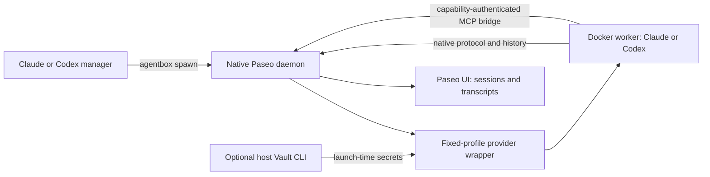

# agentbox

**Claude Code and Codex workers in Docker, visible as real [Paseo](https://paseo.sh) sessions.**

A manager agent calls one command. A fixed profile selects the image, mounted
repositories, network, tool credentials and container privilege. Paseo owns the
worker's timeline, permissions, parent link and lifecycle.

```bash
agentbox spawn --detach claude "Review the authentication code; do not change files"
agentbox spawn --detach codex "Add tests in this worktree"
agentbox status AGENT_ID
agentbox logs AGENT_ID --json
agentbox archive AGENT_ID
```

This is a small experimental integration, built and exercised in a homelab.
It is not an official Paseo, Anthropic or OpenAI project.

## What it does

- Lets native Claude **or** Codex managers delegate to either provider in Docker.
- Keeps workers visible in Paseo using Claude's native SDK stream and Codex's
  app-server protocol, rather than substituting a headless print command.
- Supports shared session history, repo/worktree mounts, normal provider
  permission requests, interruption and container cleanup.
- Resolves optional Vault secrets on the host at container launch. Secret
  values are not written into Paseo provider configuration.
- Includes base, sudo, nvm and Google Cloud CLI images, plus GitLab support.
- Pins Claude Code **2.1.329** and Codex **0.171.0** in the images, with Claude's
  auto-updater disabled. Builds and authentication use the upstream services;
  no prebuilt image is published by this repository.



## Quick start

The visible-worker integration expects **Paseo running natively on a Linux
Docker host**, as a regular user with Docker access. Install and authenticate
Paseo, Claude Code and Codex first. Docker, Bash and Python 3 are required on
the host. Vault is optional. Tested with Paseo **0.16.2**; other SDK/CLI versions
may need adjustments. macOS Bash 3.2 wrapper tests pass, but the complete
provider deployment was tested on Linux.

```bash
git clone https://github.com/luctrate/agentbox.git
cd agentbox
export PATH="$PWD/bin:$PATH"

# Build only the base image to begin. Run as the same user as Paseo.
agentbox build base

# Mount the parent directories containing your checkouts AND worktrees.
# Create these first, or substitute directories you already use.
mkdir -p "$HOME/projects" "$HOME/worktrees"
python3 deploy/configure.py \
  --mount "$HOME/projects" --mount "$HOME/worktrees" --apply
paseo reload
```

The helper backs up an existing Paseo config, merges `claude-box` and
`codex-box`, and enables agent MCP injection. Without `--apply`, it only
writes profiles and provider definitions for inspection. It does not install
Paseo, authenticate accounts, configure networking or restart the daemon.

**Before spawning workers, complete the [Docker-to-Paseo MCP route](docs/paseo.md#make-paseos-mcp-endpoint-reachable).**
Then ensure the daemon's environment has this repository's `bin` on `PATH`;
add the manager instructions in [docs/manager-instructions.md](docs/manager-instructions.md).

```bash
export AGENTBOX_PROFILE_DIR="$HOME/.config/agentbox/profiles"
cd "$HOME/projects/YOUR_REPOSITORY"
agentbox spawn --detach codex "Read README.md and report the project structure"
```

Open Paseo: the new worker has a `[box:codex]` title. A call from a native
Paseo manager inherits its workspace and parent-agent context. A call from an
ordinary shell creates an independent session.

Full setup, a manual provider configuration, private CA handling and worktree
examples are in **[the Paseo integration guide](docs/paseo.md)**.

## Images and profiles

| Image | Tools / privilege |
| --- | --- |
| `agentbox/base` | Claude, Codex, git, glab, jq, ripgrep, Python, Node 22; non-root |
| `agentbox/sudo` | Base + passwordless sudo inside the container |
| `agentbox/nvm`, `agentbox/nvm-sudo` | nvm and an LTS Node installation |
| `agentbox/gcloud`, `agentbox/gcloud-sudo` | Google Cloud CLI and service-account init hook |

`agentbox build` builds all six; a named target builds just that image. Build
the base before its children, and the sudo image before sudo children:

```bash
agentbox build base sudo nvm-sudo
python3 deploy/configure.py \
  --mount "$HOME/projects" --mount "$HOME/worktrees" --with-node --apply
paseo reload
```

Profile files are trusted Bash configuration. A profile controls scope and
privilege; callers choose a profile and a task. See [profiles and secrets](docs/profiles.md)
for the schema, GitLab/Vault setup, CLI-only mode, and image version updates.

## Lifecycle

```bash
agentbox profiles
agentbox spawn --detach PROFILE "TASK"   # first-class Paseo session
agentbox status AGENT_ID
agentbox wait AGENT_ID --timeout 60
agentbox logs AGENT_ID --json
agentbox stop AGENT_ID                   # interrupt a turn
agentbox archive AGENT_ID                # release runtime, retain history
agentbox ps                             # containers + exact Paseo agent IDs
```

A worker can be **idle while its container is still running**. Paseo retains
resumable runtimes; idle is not shutdown. Archive a finished worker when you
want its runtime released. A wait can return a pending permission request;
review it in Paseo before treating the task as complete.

`agentbox run` is also available without Paseo, but its subprocess is **not
visible in Paseo**. See [CLI-only mode](docs/profiles.md#cli-only-mode).

## Scope and security

These are development containers, **not a complete untrusted-agent isolation
system**. Profile mounts are writable unless explicitly read-only. Auth
folders are shared read-write so the upstream CLIs can refresh credentials
and Paseo can read history. Credentials intentionally injected into a worker
are accessible to that worker and to Docker administrators.

A manager with host shell/Docker access can bypass the profiles. Profiles can
also contain raw Docker flags and shell code, so only use trusted profiles.
Default bridge networking permits outbound connectivity, subject to the
host's routing/firewall. No egress policy, temporary credential broker or
research/internal-agent separation is implemented here. Workers do not mount
the Docker socket by default. Review [the security model](SECURITY.md) before
using this with sensitive tools.

## Verification

```bash
python3 -m unittest discover -s tests -p 'test_*.py' -v
```

The wrapper regression suite checks native protocol forwarding, selective MCP
URL rewriting, preservation of capability headers, multiline secrets without
secret values in Docker argv, fail-closed Vault reads, Linux sudo group
handling, fixed-provider spawn, and clean version probes with stdin open.
The setup helper is tested with temporary home/config fixtures.

Live checks on the original Linux deployment covered both manager-to-worker
directions, rendered Paseo timelines, MCP permission approvals, transcript
restoration after a separate daemon restart, worktree placement, nvm/sudo,
Vault-backed GitLab reads and interrupt/archive cleanup. These were manual
integration checks, not CI guarantees for arbitrary environments. `/rewind`,
the root provider tier and real Cloud DNS changes were not verified.

See [CONTRIBUTING.md](CONTRIBUTING.md) for safe changes and protocol upgrades.

## License

MIT for this project's code. Docker, Paseo, the provider CLIs and bundled tools
retain their own licenses, service terms and authentication requirements.
