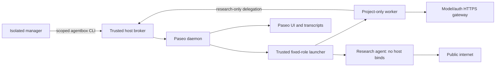

# agentbox

**Claude Code and Codex agents in Docker, visible as native [Paseo](https://paseo.sh) sessions.**

An `asp.now/v1alpha1` YAML catalog defines each agent's image, harness, workspace,
network, tool credentials and delegation rights. A trusted host launcher and
Python broker enforce those choices outside the agent container. Paseo owns the
conversation, parent links, question cards and lifecycle.

This is an experimental homelab integration, not an official Paseo, Anthropic
or OpenAI project. It is intended for a trusted personal development host, not
hostile multi-tenant workloads. See [SECURITY.md](SECURITY.md).

## Available features

- **Claude and Codex managers/workers:** exact harness versions and immutable
  image IDs, with optional native host agents alongside isolated managers.
- **Scoped delegation:** per-definition allowlists, concurrency limits, bounded
  depth, cycle rejection, direct-child ownership and revocable runtime capabilities.
- **Follow-ups and clarification:** message an existing worker and answer its
  supported question cards without granting command/file approvals.
- **Mediated commands:** exact argv allow/deny/review rules, with native command tools disabled and host-enforced container execution.
- **Reviewer agents:** a separate Claude/Codex session can authorize one exact command with a bounded, auditable decision.
- **Durable lifecycle:** SQLite launch ownership, idempotent request IDs and
  conservative handling of ambiguous launches/deliveries.
- **Container controls:** non-root execution, CPU/memory/PID limits, read-only
  roots/projects, dropped capabilities and privilege-escalation policy.
- **Vault integration:** selected `vaultPathToEnv` mappings are resolved on the
  host; agents cannot choose arbitrary Vault paths or Docker arguments.
- **Network policy:** Docker bridges plus IPv4 firewall rules; optional internal
  networks with an exact-host HTTPS model/authentication proxy.
- **Public research:** agents with internet access, no host bind mounts, no
  internal-service access and no injected external-tool credentials.
- **Model-only coding workers:** mount only their project, reach model/auth
  services and the scoped broker, and delegate public research to another agent.
- **Headless browsing:** optional Playwright/Chromium image, rendered text,
  JavaScript evaluation, screenshots and the full interaction API.

The original Bash-profile integration is also included for simple Docker workers
managed from a trusted native host agent. Its setup and security model differ
from the catalog workflow.

## Catalog workflow

Start with [the installation guide](docs/installation.md). It includes protected
runtime installation, systemd templates, authentication, image builds, proxy CA
setup and first activation on an existing native Linux Paseo/Docker host.

- [Basic catalog](examples/catalog.yaml) and [platform bindings](examples/platform.json)
- [Research/model-only catalog](examples/research-catalog.yaml) and [bindings](examples/research-platform.json)
- [Command policies and reviewer agents](docs/command-policies.md), [catalog](examples/command-catalog.yaml) and [bindings](examples/command-platform.json)
- [Catalog schema and operator](docs/catalog.md)
- [Research workers and browser usage](docs/research-workers.md)

Replace all example zero image IDs and adapt the administrator-controlled host
bindings. The checked-in examples contain no live credentials or deployment
configuration.



Inside a catalog manager:

```bash
agentbox profiles
agentbox spawn --detach offline-codex "Implement the change in this project"
agentbox status WORKER_ID
agentbox logs WORKER_ID --json
agentbox send WORKER_ID "Use the existing API and add regression tests"
agentbox questions WORKER_ID
agentbox answer WORKER_ID QUESTION_REQUEST_ID --answers '{"Exact question key":"Answer"}'
agentbox archive WORKER_ID
```

An offline worker can launch only its configured research profiles:

```bash
agentbox spawn --detach research-claude "Research this public API and cite sources"
```

Inside a research agent with the browser image:

```bash
research-browser https://example.com --screenshot /tmp/page.png
research-browser https://example.com --evaluate 'document.title'
```

Workers remain first-class Paseo sessions. An idle agent can still have a running
container; archive it to release the runtime. Managers poll for results/questions;
automatic wake-up is not implemented. A queued message may not have started its
next turn yet, so confirm its delivery/result in logs.

## Images and versions

| Image | Purpose |
| --- | --- |
| `agentbox/base` | Claude, Codex, git, glab, Python, Node 22; non-root, no sudo |
| `agentbox/ephemeral` | Base plus private stdin model-login bootstrap and scoped client |
| `agentbox/research-browser` | Ephemeral base plus Playwright and Chromium headless shell |
| `agentbox/sudo` | Base plus sudo inside the container |
| `agentbox/nvm`, `agentbox/nvm-sudo` | nvm and Node tooling |
| `agentbox/gcloud`, `agentbox/gcloud-sudo` | Google Cloud CLI and service-account init hook |

Claude Code **2.1.329**, Codex **0.171.0**, Playwright **1.65.1**, and the optional
model proxy's mitmproxy **12.3.1** are pinned. Playwright selects its matching
Chromium revision. The catalog pins the final image ID/digest; source builds
still consume upstream OS packages. No prebuilt images are published here.

Tested with native Linux Paseo **0.16.2**. The messaging adapter uses Paseo's
installed native client module and needs compatibility checks on upgrades.

## Original Bash-profile workflow

For the original host-manager integration:

```bash
git clone https://github.com/luctrate/agentbox.git
cd agentbox
export PATH="$PWD/bin:$PATH"
agentbox build base
mkdir -p "$HOME/projects" "$HOME/worktrees"
python3 deploy/configure.py \
  --mount "$HOME/projects" --mount "$HOME/worktrees" --apply
paseo reload
```

This helper configures `claude-box` / `codex-box` and enables the native Paseo MCP
bridge. Follow [the original Paseo guide](docs/paseo.md), including its MCP route
and model logins, before spawning. It does not install the catalog broker or
network isolation, and refuses to overwrite an existing restricted deployment.
[Profiles and tool credentials](docs/profiles.md) describe the shell profile
format and CLI-only runs. `agentbox run` does not create a visible Paseo session.

## Security boundaries

Catalog authorization lives in protected host code/policy, not an agent-writable
client or MCP configuration. Agent containers receive only their configured
mounts and credentials. A credential deliberately given to an agent remains
readable by it. Research requests are an intentional data channel; no automatic
DLP, tool-token issuance or automatic service-token rotation is claimed.

The host Paseo daemon/plugins/Git operations, Docker/kernel, launcher, operator
and optional TLS-terminating model proxy are trusted. Native host agents retain
their normal host-account authority when enabled. The browser uses the research
container boundary; Chromium's additional process sandbox is disabled under the
current restricted Docker profile. Read [the complete security model](SECURITY.md)
before choosing profiles for sensitive work.

## Verification

```bash
python3 -m venv .venv
.venv/bin/python -m pip install -r requirements.txt
.venv/bin/python -m unittest discover -s tests -p 'test_*.py' -v
node --check images/research-browser/research-browser.cjs
```

Fixture tests run on Linux/macOS without credentials or a Docker daemon. Live
homelab checks additionally covered both model providers, nested research
handoffs, clarification/reply flows, actual mount/egress denial, proxy Host
fronting rejection, token cleanup and the browser's rendering/click/screenshot
workflow. These observations do not prove another host's firewall or deployment.

[The installation guide](docs/installation.md#verification) gives the reproducible
browser smoke command. CI also scans Git history with pinned Gitleaks. Never
commit login files, CA private keys, generated policy/state or private handoffs.
See [CONTRIBUTING.md](CONTRIBUTING.md) for development and protocol upgrades.

## License

[MIT](LICENSE). Upstream tools and model services retain their own licenses and terms.
